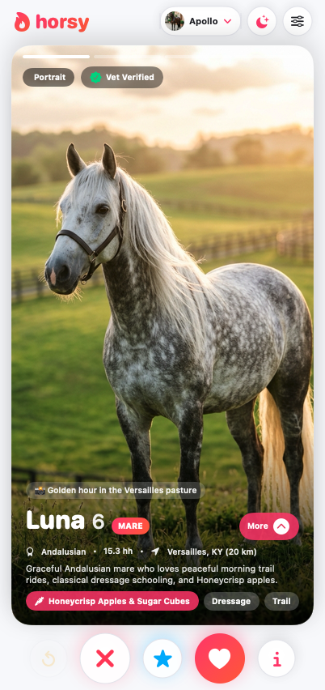
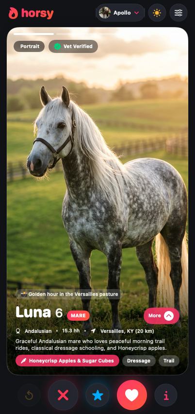
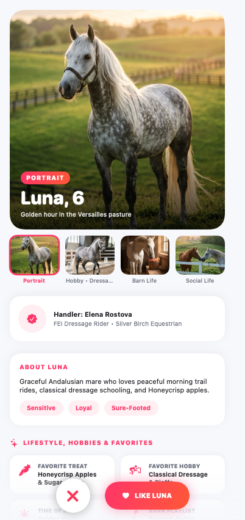
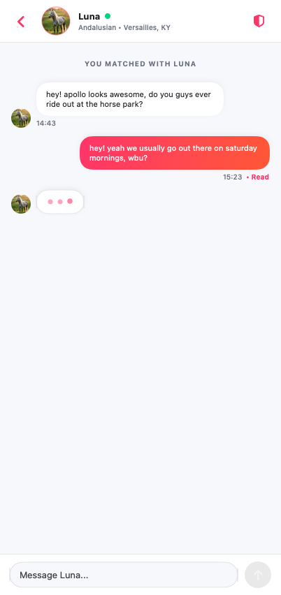
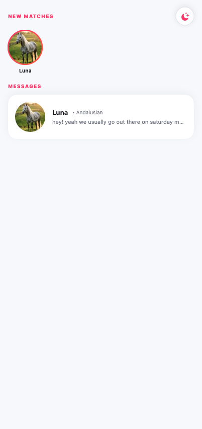
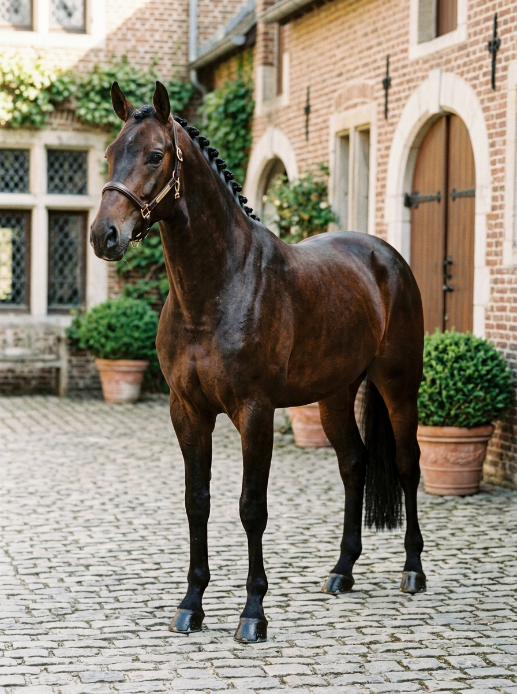
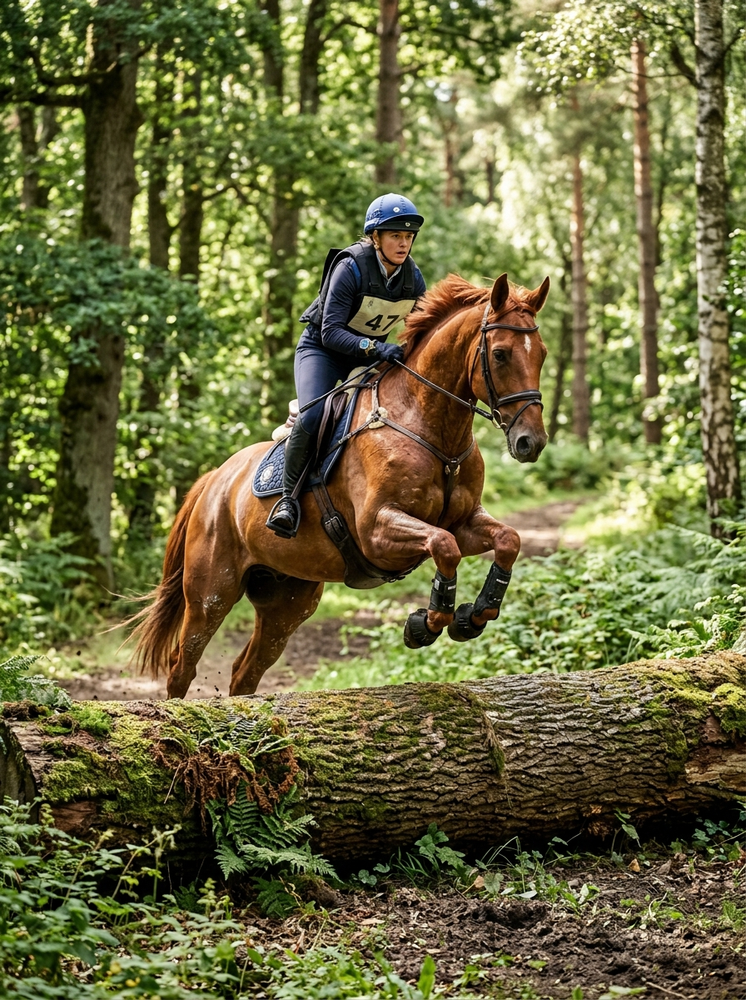

# 🔥 Horsy — Tinder for Horses

**Horsy** is a full-stack Swift mobile & desktop matching application for horses and their owners/handlers. Inspired by Tinder's signature Red & White card-stack experience, horse owners can swipe through nearby horses, explore rich multi-photo lifestyle & hobby profiles, match on mutual right-swipes, switch seamlessly between **Light Mode** and **Dark Mode**, and chat in real time with casual, human-like conversational replies.

---

## 📱 App Screenshots

| Discover (Light Mode) | Discover (Dark Mode) | Horse Lifestyle & Hobby Profile |
| :---: | :---: | :---: |
|  |  |  |

| Real-Time Chat & 3-Dots Typing | Matches & Messages |
| :---: | :---: |
|  |  |

---

## 🐴 Featured Horses & Lifestyle Gallery

Every horse on **Horsy** includes a 4-photo lifestyle album (**Portrait**, **Hobby / Action**, **Barn Life**, and **Social / Trail**), verified handler credentials, favorite treats, and personality prompts:

| **Apollo** (Hanoverian Stallion) | **Luna** (Andalusian Mare) | **Bella** (Holsteiner Show Jumper) | **Maverick** (Tobiano Paint) |
| :---: | :---: | :---: | :---: |
|  |  |  |  |
| **Thunder** (Friesian Stallion) | **Duchess** (Gypsy Vanner Mare) | **Cleo** (Buckskin Lusitano) | **Blaze** (Irish Sport Horse) |
|  |  |  |  |

---

## ✨ Key Features

- **Tinder-Style Card Stack & Physics**:
  - 3-card depth stack (`scaleEffect` + vertical offset interpolation as you drag the top card).
  - Top/bottom grab-location pivot tilt, spring fly-off animations (`LIKE` / `NOPE` / `SUPER LIKE` stamps), **Rewind**, and **It's a Match!** celebration overlay.
  - Multi-photo story bars at the top of each card—tap the left/right edges of a card to flip through a horse's **Portrait**, **Hobby**, **Barn Life**, and **Trail** photos.
- **Rich Equine Lifestyle & Hobby Profiles**:
  - Expandable profile sheet featuring a 4-photo thumbnail strip, verified handler & barn badge, 6 lifestyle/hobby badges (*Favorite Treat*, *Favorite Hobby*, *Barn Playlist*, *Social Vibe*), Hinge/Tinder-style personality prompt cards, and a full-bleed photo stream.
- **Natural Human-Style Chat & Animated 3-Dots Typing Bubble**:
  - Connected to an OpenAI-compatible chat completions endpoint (`https://text.pollinations.ai/openai`) with full multi-turn conversation history and an offline context-aware fallback so matched horse owners text back casually like real people on Tinder.
  - Smooth 60fps bouncing three-dots (`• • •`) typing indicator bubble, `Return`/`Enter` instant send, and auto-scrolling message stream.
- **1-Tap Light Mode & Dark Mode**:
  - Switch instantly between Tinder Red & White **Light Mode** and obsidian **Dark Mode** from the top header bar (`☀️` / `🌙`) or the **Profile → Appearance** settings card.
- **Full-Stack Swift Monorepo**:
  - **`SharedModels`**: Cross-platform `Codable`, `Sendable` DTOs, Haversine coarse distance calculator, and UGC safety validators shared between backend and client.
  - **`Server`**: Vapor 4 REST + WebSocket backend with PostgreSQL 16 (Fluent ORM), JWT access/refresh rotation, atomic mutual-like match transactions, multipart photo uploads, and APNs push notification service.
  - **`iOSApp`**: SwiftUI iOS 17+ / macOS 14+ client using `@Observable` MVVM architecture, `KeychainTokenStore`, and `APIClient` / `MockAPIClient` actors.

---

## 🗂️ Monorepo Layout

```text
/
├── SharedModels/      # Shared Swift Package (DTOs, Haversine distance, UGC content filter)
├── Server/            # Vapor 4 backend (Fluent + PostgreSQL, JWT auth, WebSockets, StorageService, APNs)
│   └── Public/uploads/demo/  # 16 photorealistic horse portrait, hobby, and lifestyle images
├── iOSApp/            # SwiftUI mobile & desktop client (@Observable MVVM, Tinder card physics, LLM chat)
├── docs/screenshots/  # High-resolution app UI screenshots (Light Mode, Dark Mode, Detail, Chat, Messages)
├── demo.sh            # End-to-end automated live backend & API demo script
├── .env.example       # Template for server environment variables
└── README.md          # Project documentation & visual showcase
```

---

## 🚀 Quick Start

### 1. Run the Horsy Mobile App Window Immediately

Build and launch the standalone **Horsy** mobile window on macOS (pre-loaded with 10 horses, 16 lifestyle photos, instant skip-auth mode, Dark/Light Mode toggle, and live chat):

```bash
cd iOSApp
swift build --product StallionMatchDesktop
./.build/arm64-apple-macosx/debug/StallionMatchDesktop
```

### 2. Run the Full-Stack Backend + End-to-End Demo (`./demo.sh`)

Run the automated end-to-end script (starts PostgreSQL 16 in Docker, boots the Vapor 4 server, registers two horse owners, creates horse profiles, uploads photos, queries the discovery feed, performs a mutual right-swipe match, and exchanges real-time chat messages):

```bash
chmod +x demo.sh
./demo.sh
```

### 3. Run Unit & Integration Tests

```bash
# SharedModels tests
cd SharedModels && swift test

# Vapor Server integration tests
cd ../Server && swift test

# Client ViewModel & API tests
cd ../iOSApp && swift build --build-tests
```

---

## 🔌 REST & WebSocket API Reference (`/api/v1`)

| Method | Path | Auth | Description |
| :--- | :--- | :---: | :--- |
| `GET` | `/api/v1/health` | No | Health check (`{"status":"ok"}`) |
| `POST` | `/api/v1/auth/signup` | No | Email + password registration |
| `POST` | `/api/v1/auth/login` | No | Email + password login |
| `POST` | `/api/v1/auth/apple` | No | Sign in with Apple identity token exchange |
| `POST` | `/api/v1/auth/refresh` | No | Rotate refresh token for new token pair |
| `POST` | `/api/v1/auth/logout` | Bearer | Revoke user refresh tokens |
| `GET` | `/api/v1/users/me` | Bearer | Fetch current user profile |
| `PATCH` | `/api/v1/users/me` | Bearer | Update display name, notification toggles, terms |
| `DELETE` | `/api/v1/users/me` | Bearer | Permanently delete account & cascade all data |
| `GET` | `/api/v1/horses` | Bearer | List authenticated user's horse profiles |
| `POST` | `/api/v1/horses` | Bearer | Create a horse profile |
| `PATCH` | `/api/v1/horses/:horseID` | Bearer | Update horse profile |
| `POST` | `/api/v1/horses/:horseID/photos` | Bearer | Multipart JPEG upload (`<= 10 MB`, max 6 photos) |
| `GET` | `/api/v1/discovery` | Bearer | Paginated discovery feed with Haversine distance & filters |
| `POST` | `/api/v1/swipes` | Bearer | Record like/pass swipe & atomically create match on mutual like |
| `GET` | `/api/v1/matches` | Bearer | List active matches |
| `GET` | `/api/v1/conversations` | Bearer | List conversations with last message & unread badge count |
| `GET` | `/api/v1/conversations/:id/messages` | Bearer | Fetch message history & mark incoming messages read |
| `POST` | `/api/v1/conversations/:id/messages` | Bearer | Send message & broadcast over WebSocket / APNs |
| `WS` | `/api/v1/ws/conversations/:id` | Bearer | Real-time bidirectional chat & read-receipt stream |
| `POST` | `/api/v1/reports` | Bearer | Report a user, horse profile, or message |
| `POST` | `/api/v1/blocks` | Bearer | Block a user (immediately hides from discovery, matches & chat) |
